<div align="center">

<!-- Header Wave -->


# 👋 Hi There!

</div>

## 💫 About Me

```yaml
name: "KWON HAJIN"
role: "Backend & AI Developer"
education: "Sejong Cyber University"
interests:
  - "Scalable Backend Architecture"
  - "AI Agents & Machine Learning"
  - "System Programming & Cloud Infrastructure"
focus: "Building practical, high-performance services"
```

---

## 🛠️ Tech Stack

<div align="center">

### 💻 Languages
<p>
  
  
  
  
  
  
</p>

### ⚙️ Backend & AI
<p>
  
  
  
  
</p>

### 🎨 Frontend & Mobile
<p>
  
  
  
  
</p>

### 🗄️ Database & Cloud / DevOps
<p>
  
  
  
  
  
</p>

<br/>

<!-- Skill Icons Summary -->
<a href="https://skillicons.dev">
  
</a>

</div>

---

## 📊 GitHub Analytics

<div align="center">
  
</div>

<div align="center">
  
  
</div>

<div align="center">
  
  
</div>

<!-- Footer Wave -->

